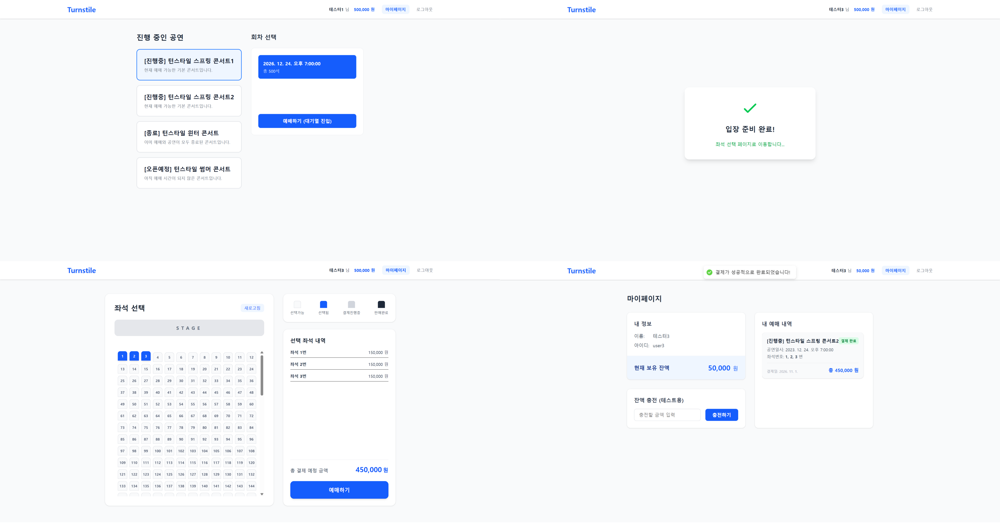
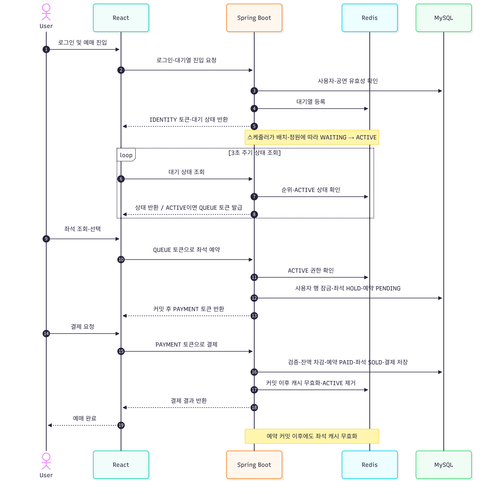
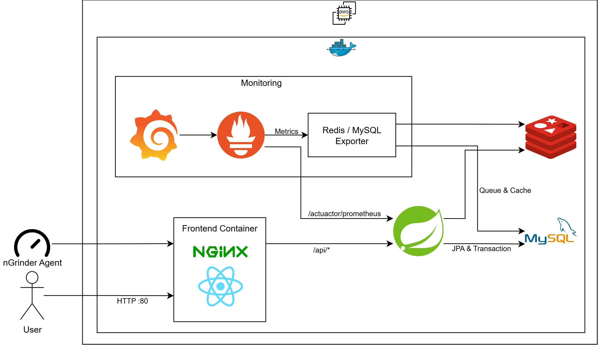
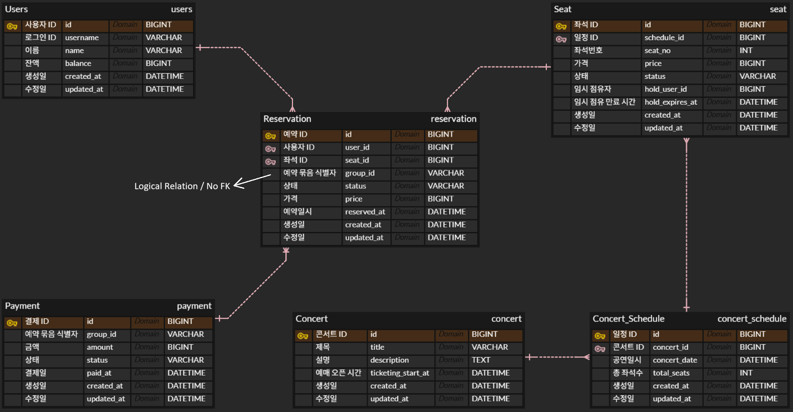
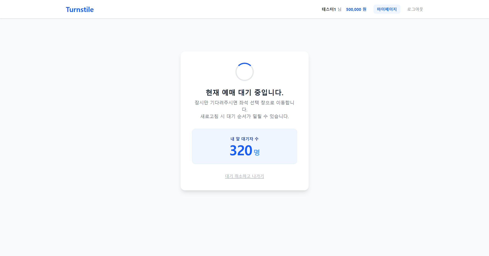
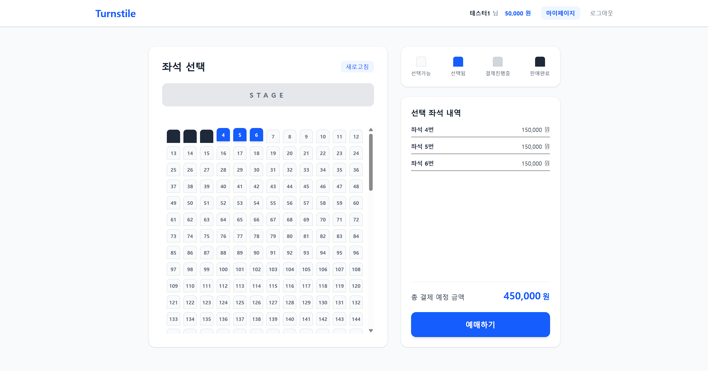
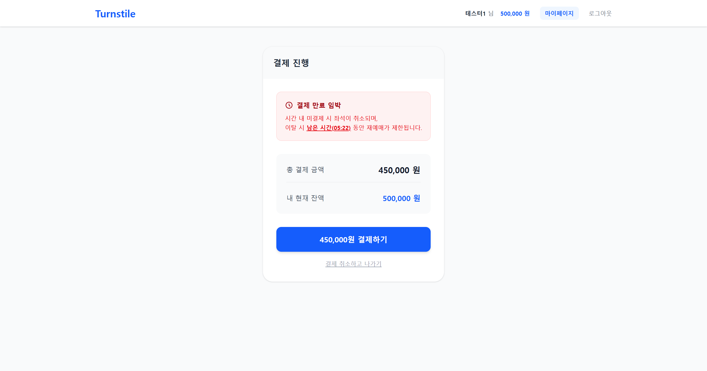
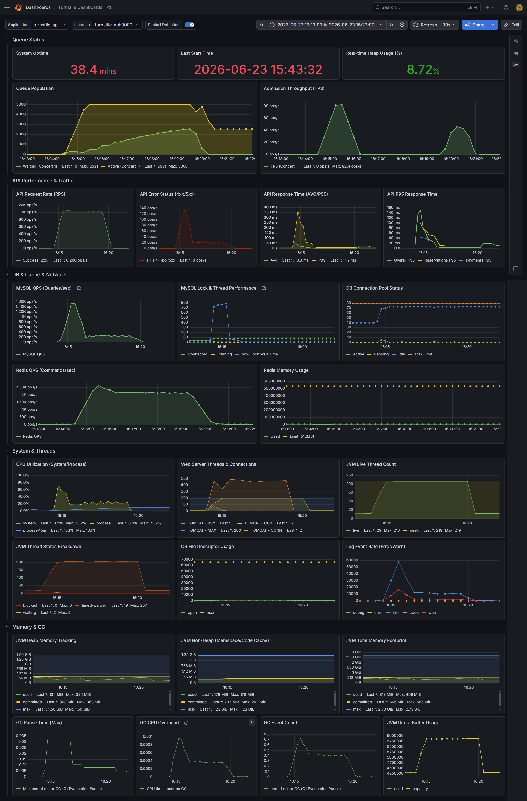
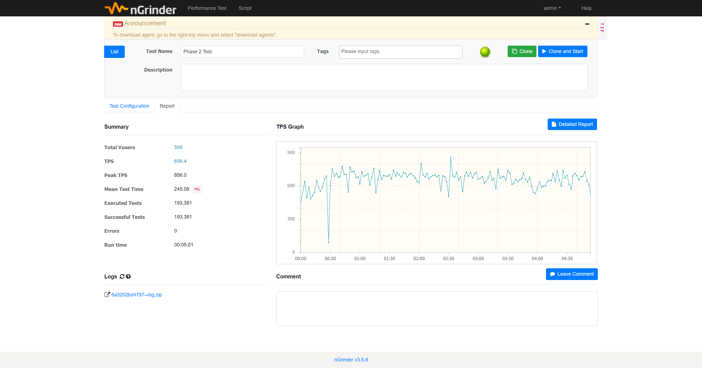

# 🎟️ Turnstile

> 트래픽이 한순간에 집중되는 티켓 예매 상황을 가정해, 대기열 진입부터 좌석 선점과 결제까지의 흐름을 구현한 콘서트 티켓팅 서비스입니다.

개인 프로젝트로 기획, 시스템 설계, 프론트엔드, 백엔드, 인프라 및 테스트를 진행했습니다.

단순한 예매 기능 구현을 넘어 **동시 요청에서도 좌석이 중복 판매되지 않는 것**, **대기 사용자를 제어된 속도로 입장시키는 것**, **DB와 Redis 사이의 불일치 가능성을 줄이는 것**에 초점을 맞췄습니다.



## 📌 프로젝트 개요

| 항목 | 내용 |
| --- | --- |
| 프로젝트 형태 | 개인 프로젝트 |
| 개발 기간 | 2026.02.07 ~ 2026.07.02 |
| 담당 범위 | 기획, 시스템 설계, 프론트엔드, 백엔드, 인프라, 테스트 |
| 주요 기능 | 로그인, 콘서트 조회, 대기열, 좌석 임시 점유, 결제, 잔액 충전, 예매 내역 조회 |
| 핵심 목표 | 동시성 제어, 트래픽 완충, 데이터 정합성, 장애 관측 가능성 확보 |
| 배포 환경 | 로컬 Docker Compose, Nginx / AWS EC2 배포 구성 |

## 🛠️ 기술 스택

| 영역 | 기술 |
| --- | --- |
| Frontend | React 19, TypeScript, Vite, React Router, Zustand, Axios, Tailwind CSS |
| Backend | Java 21, Spring Boot 3.4, Spring MVC, Spring Data JPA, Validation, JWT |
| Data | MySQL 8.0, Redis 7.4 |
| Test | JUnit 5, Mockito, MockMvc, Spring Boot Test, Testcontainers, nGrinder |
| Observability | Actuator, Micrometer, Prometheus, Grafana |
| Infra / CI·CD | Docker, Docker Compose, Nginx, GitHub Actions, Docker Hub / 배포 대상: AWS EC2 |

## 🏗️ 아키텍처 및 예매 흐름

### 🔄 예매 흐름

1. 사용자가 로그인하고 공연 유효성 검증 후 대기열에 등록해 `IDENTITY` 토큰과 대기 상태를 반환받습니다.
2. 스케줄러가 배치·정원에 따라 `WAITING → ACTIVE`로 전환하며, 3초 주기 상태 조회를 통해 활성 상태가 확인되면 `QUEUE` 토큰을 발급받습니다.
3. 좌석을 선택하면 Redis에서 `ACTIVE` 권한을 확인한 뒤, 사용자 행 잠금과 DB 조건부 업데이트로 임시 점유(`HOLD`)를 시도합니다.
4. 예약 커밋 이후 좌석 캐시를 무효화하고 `PAYMENT` 토큰을 발급받습니다.
5. 결제 요청 시 토큰·예약 정보를 검증하고 단일 트랜잭션에서 잔액 차감, 예약 확정(`PAID`), 좌석 판매(`SOLD`) 및 결제 이력을 저장합니다.
6. 결제 커밋 이후 좌석 캐시를 무효화하고 활성 대기열(`ACTIVE`)에서 사용자를 제거합니다.

<details>
<summary>흐름도</summary>



</details>

### 🖥️ 시스템 구성도



### 🗄️ ERD



## ✨ 주요 기능

### 1. 콘서트 예매 대기열

- Redis Sorted Set으로 콘서트별 대기 순서를 관리합니다.
- Redis `INCR`로 순번을 발급해 Redis 서버가 요청을 처리한 순서대로 대기 순서를 결정합니다.
- Lua Script로 대기열 등록과 `WAITING → ACTIVE` 전이를 각각 원자적으로 처리합니다.
- 스케줄러는 이전 실행 종료 후 1초 간격으로 동작하며, 콘서트별 배치 크기와 ACTIVE 수용량에 맞춰 대기자를 입장시킵니다.



### 2. 좌석 중복 선점 방지

- 동일 사용자의 예약·결제 요청은 사용자 행 잠금으로 직렬화하여 동일 콘서트에 여러 미결제 예약 그룹이 생성되는 것을 방지합니다.
- 선택한 좌석 ID의 중복을 제거한 뒤 오름차순으로 정렬합니다.
- 별도의 애플리케이션 분산 락 없이 `AVAILABLE` 좌석만 `HOLD`로 변경하는 조건부 벌크 업데이트를 사용합니다.
- 요청 좌석 수와 실제 변경 행 수가 다르면 전체 트랜잭션을 롤백합니다.



### 3. 단계별 접근 권한

예매 진행 단계마다 필요한 JWT를 분리해 이전 단계의 권한만으로 다음 단계 API에 접근할 수 없도록 구성했습니다.

| 단계 | 토큰 | 접근 범위 |
| --- | --- | --- |
| Level 1 | `IDENTITY` | 사용자 식별, 대기열, 마이페이지 |
| Level 2 | `QUEUE` | IDENTITY 권한 및 좌석 조회·예약 |
| Level 3 | `PAYMENT` | 하위 단계 권한 및 토큰에 지정된 예약 그룹의 결제 |

JWT의 유효성과 토큰 종류는 Interceptor에서 먼저 검증해 권한이 없는 요청을 비즈니스 로직과 DB 접근 전에 차단합니다.

### 4. 안전한 결제 확정

- PAYMENT 토큰의 예약 그룹과 요청 그룹을 대조하고, 예약 소유자·콘서트·공연 시각·서버 계산 금액을 검증합니다.
- 예약 상태를 `PENDING → PAID`로 조건부 변경해 중복 결제를 차단합니다.
- 잔액 차감, 좌석 `SOLD` 처리, 예약 확정 및 결제 이력 저장을 하나의 트랜잭션으로 처리합니다.
- 트랜잭션 커밋 이후 좌석 캐시를 무효화해 롤백 시 발생할 수 있는 캐시 불일치를 방지합니다.



### 5. 조회 캐시와 Cache Stampede 방어

- 콘서트와 회차 조회 결과를 Redis에 캐시합니다.
- 좌석 캐시가 없을 때 `SETNX` 기반 락을 획득한 요청만 DB를 조회합니다.
- 락을 획득하지 못한 요청은 50ms 후 캐시를 한 번 재조회합니다.
- 재조회 시에도 데이터가 없다면 `429 Too Many Requests`로 빠르게 실패시켜 요청 스레드가 장시간 적체되는 것을 방지합니다.
- 좌석 상태 변경 시에는 트랜잭션 커밋 이후 캐시를 무효화해 DB와 캐시의 불일치 가능성을 줄였습니다.

### 6. 모니터링

- Spring Boot Actuator와 Micrometer로 애플리케이션 메트릭을 노출합니다.
- Prometheus와 Grafana로 JVM, HTTP 요청 및 HikariCP 메트릭을 확인할 수 있습니다.
- Redis Exporter와 MySQL Exporter를 통해 데이터 계층의 상태도 함께 관찰합니다.

<details>
<summary>모니터링 대시보드</summary>



</details>

## 📊 핵심 검증 결과

> `nGrinder`를 활용해 **대기열 폴링(1,000 VUser)** 및 **좌석 예약 경합(500 VUser)** 시나리오에서 튜닝 전·후를 비교 검증한 결과입니다.

| 검증 항목 | 결과 |
| --- | --- |
| 대기열 폴링 부하 | 전체 평균 TPS 779.99 → 944.86, 전체 평균 응답 시간 116.67ms → 8.53ms |
| 좌석 경합 부하 | 결제 평균 TTFB 4,530.20ms → 765.06ms, Max Hikari Pending 270개 → 0개 |
| 데이터 정합성 | 동일 좌석 중복 예약 0건, 동일 그룹 중복 PAID 결제 없음, 매출 대조 오차 0원 |
| HTTP 오류 관측 | Grafana에서 5xx 요청률 상승 미관측 / Errors와 Response Errors 별도 집계 |

<details>
<summary>부하테스트 대시보드</summary>



</details>

## 🔌 API 요약

| Method | Endpoint | 설명 | 권한 |
| --- | --- | --- | --- |
| `POST` | `/api/v1/auth/login` | 사용자 로그인 | Public |
| `GET` | `/api/v1/concerts` | 콘서트 목록 조회 | Public |
| `GET` | `/api/v1/concerts/{concertId}/schedules` | 콘서트 회차 조회 | Public |
| `POST` | `/api/v1/queue/entry` | 대기열 진입 | IDENTITY |
| `GET` | `/api/v1/queue/status?concertId={id}` | 대기 순번 및 입장 상태 조회 | IDENTITY |
| `GET` | `/api/v1/schedules/{scheduleId}/seats` | 좌석 상태 조회 | QUEUE |
| `POST` | `/api/v1/reservations` | 좌석 임시 점유 | QUEUE |
| `GET` | `/api/v1/reservations/my` | 내 예매 내역 조회 | IDENTITY |
| `POST` | `/api/v1/payments` | 결제 및 예매 확정 | PAYMENT |
| `GET` | `/api/v1/users/me/balance` | 내 잔액 조회 | IDENTITY |
| `PATCH` | `/api/v1/users/me/balance` | 시연용 잔액 충전 | IDENTITY |

상세 요청·응답 스키마는 Swagger UI에서 확인할 수 있습니다.

## 🚀 로컬 실행

### 사전 준비

- Docker
- Docker Compose
- 직접 실행하는 경우 Java 21, Node.js 20.19 이상 또는 22.12 이상

### 1. 환경 변수 설정

다음 항목을 직접 설정한 뒤 `.env`를 생성합니다.

```env
TZ=Asia/Seoul

MYSQL_DATABASE=turnstile
MYSQL_ROOT_PASSWORD=your_root_password

DB_USER=root
DB_PASSWORD=your_root_password

SPRING_DATASOURCE_URL=jdbc:mysql://mysql:3306/turnstile?serverTimezone=Asia/Seoul&characterEncoding=UTF-8&rewriteBatchedStatements=true&profileSQL=false

# 공백 없는 UTF-8 기준 32바이트 이상의 새로운 임의 키를 입력합니다.
# 빈 값과 기존에 공개된 키는 사용할 수 없습니다.
JWT_SECRET=
```

### 2. 전체 서비스 실행

```bash
docker compose up --build -d
```

| 서비스 | 주소 |
| --- | --- |
| Web | `http://localhost` |
| API | `http://localhost:8080` |
| Swagger UI | `http://localhost:8080/swagger-ui/index.html` |
| MySQL | `localhost:3307` |
| Redis | `localhost:6380` |

> local·perf 프로필은 users 테이블이 비어 있을 때 사용자 10,000명, 콘서트 4개, 좌석 2,000개를 생성합니다. 공연 일정은 고정된 예시 날짜이며, 실제 예매 가능 여부는 현재 시각을 기준으로 서버에서 판정합니다.

로그인 화면에서 `user1`부터 `user10000`까지 사용할 수 있으며 별도 비밀번호는 없습니다.

### 3. 종료

```bash
docker compose down
```

## 🧪 테스트

백엔드는 Mockito 기반 서비스 단위 테스트, MockMvc 기반 웹 테스트, 실제 MySQL을 사용하는 Repository 테스트와 인증·캐시·이벤트·결제 통합 테스트로 구성합니다.

```bash
cd backend
./gradlew test
```

프론트엔드 정적 검사와 프로덕션 빌드:

```bash
cd frontend
npm ci
npm run lint
npm run build
```